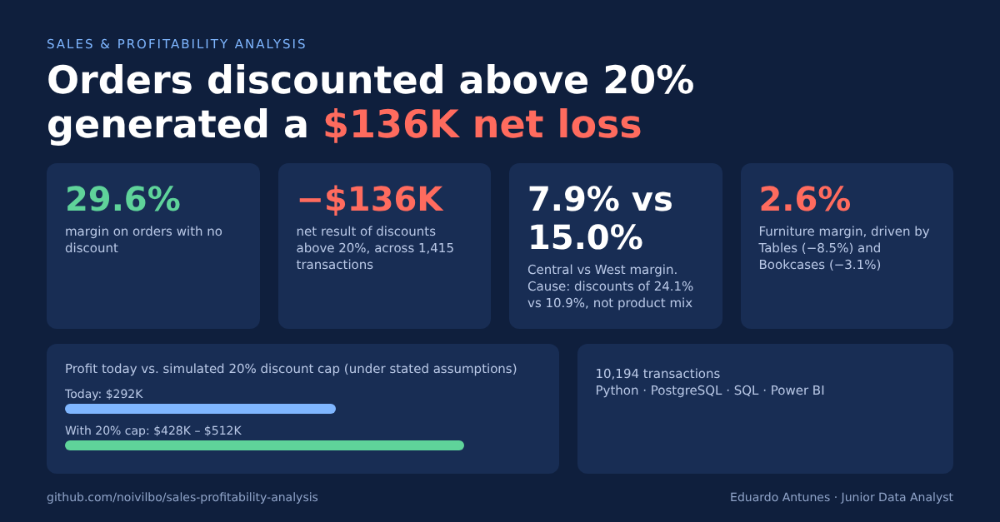

# Sales & Profitability Analysis

An end-to-end analytics project evaluating commercial performance across 2023–2026, focusing on granular loss drivers, regional disparities, and the financial impact of aggressive discounting strategies.



## Executive Summary & Key KPIs

| Metric                    | Value   | Context                                                                          |
| ------------------------- | ------- | -------------------------------------------------------------------------------- |
| **Total Sales**           | $2.33M  | Consistent upward trajectory from 2023 to 2026, with a 4.2% dip in 2024          |
| **Total Profit**          | $292K   | Net profitability impacted by high discount outliers                             |
| **Overall Profit Margin** | ~12.6%  | Stabilized around 13% after 2024                                                 |
| **Order Lines**           | 10,192  | 5,111 orders; cleaned and validated records (2 exact duplicates removed)         |

> **Note on dates:** the dataset's dates were shifted to 2023–2026, so the timeline is simulated and should not be read as real calendar results.

## Tools & Tech Stack

- **Python (Pandas)** — Data quality assessment, exact-duplicate detection, postal code standardization, strict datetime validation, and an automated rule check that stops the notebook if any rule fails. A second notebook uses `statsmodels` (weighted and unweighted regressions with robust standard errors) to test whether discounting explains Central's margin gap.
- **PostgreSQL** — Schema design, a star-schema view layer (one fact view and four dimension views) serving Power BI, validation queries that reconcile every layer, and analytical queries with CTEs and window functions (LAG).
- **Power BI Desktop** — Interactive dashboards connected directly to PostgreSQL through the native connector, with filtering by period, region, category and discount tier.

## Methodology & Data Quality

During the data preparation phase in Python, several data integrity issues were addressed to ensure a reproducible workflow:

- **Duplicates & Schema:** 10,194 raw rows → 2 exact duplicates removed (ignoring the unique row ID, and listed before removal) → 10,192 clean rows. Columns mapped to strict snake_case matching the PostgreSQL schema.
- **Postal & Geographic Consistency:** Handled international records and padded numeric US postal codes to preserve leading zeros.
- **Strict Datetime Validation:** Enforced assertions on date conversions to prevent silent parsing failures.
- **Validation:** Nine data quality rules run before export, and `sql/04_model_checks.sql` reconciles the PostgreSQL star schema against the source table (row counts, totals, orphan keys, duplicate keys).
- **Reproducibility:** Key analytical outputs are stored in [sql/results/](sql/results) for quick auditing.

## Dashboard


(For a complete view of all report pages and cross-filtering capabilities, please check the exported PDF report in [Dashboard Report](docs/dashboard_report.pdf) or review the [Power BI file](powerbi/superstore_sales_analysis.pbix)).

The dashboard covers:

- Year-over-Year temporal trajectory and monthly performance
- Granular category and sub-category drill-downs
- Regional performance disparities
- Discount tiers and profitability impact

## Key Findings & Business Insights

SQL exploration and annual trend analysis uncovered critical business drivers that go beyond basic summaries:

- **Granular Loss Drivers in Furniture & Supplies:** While the Furniture category exhibits a weak overall margin (2.6%), a deep sub-category drill-down exposes the exact root causes: Tables (−8.5%), Bookcases (−3.1%), and Supplies (−2.5%) operate at a net loss, dragging down overall profitability.
- **The True Cost of Aggressive Discounting:** Discount strategy is tightly associated with margin erosion. Order lines with 0% discount yield a healthy 29.6% profit margin, whereas discounts above 20% result in a collective net loss of ~$136,000 across 1,414 order lines; the 874 lines discounted 60% to 80% account for 57% of it on only 2.8% of sales. A simulated 20% cap points to a profit of roughly $428K–$512K against $292K today, under stated assumptions.
- **Year-over-Year Trajectory (2023–2026):** Separating seasonal aggregation into distinct annual timelines reveals clear phases:
  * 2023: Baseline performance with a ~10.5% profit margin.
  * 2024: Sales fell 4.2%, yet profit rose 20% as the margin improved.
  * 2025–2026: Sales grew +29.8% in 2025 and +21.4% in 2026, with profit margins stabilizing around 13%.
- **Regional Performance:** Central's 7.9% margin (vs. 15.0% in West) is not explained by product mix: Furniture is 32.7% of its sales, in line with other regions. Its effective discount is 24.6% (vs. 15.5% in West), and about $26K of its ~$30K profit gap comes from Office Supplies, where the effective discount is 32.4%. In Technology, where its discount is in line with West's (16.4% vs. 17.3%), Central has the highest margin of all regions (19.8%). Also, 18.9% of Central's order lines carry discounts of 60% or more (3.1% in West); without them, its margin would be 15.9% against 16.8% in West.
- **Regression check:** controlling for sub-category does not shrink Central's margin gap versus West. Adding discount absorbs about 45% of the dollar-weighted gap (and eliminates it with discount bands) and about 81% of the unweighted gap, so the size of the effect depends on the weighting and is reported both ways.

*(Explore the underlying query outputs and data models in [sql/results/](sql/results))*

## Strategic Recommendations

1. **Review clearance-level discounts (60%+) first, then cap or review discounts above 20%, testing before rolling out:** they systematically erode operating income; a limited-scope test would measure how much volume a cap costs.
2. **Portfolio Rationalization:** Audit product lines inside the Tables and Bookcases sub-categories to reprice, bundle, or discontinue chronic loss-makers.
3. **Regional Strategy Focus:** Review discounting in Central, starting with its clearance-level discounts and its Office Supplies and Furniture, using West as an internal benchmark for discount levels.

## Report

The full analysis, findings, and recommendations are available in the [Final Report](docs/Report.md).

## How to Reproduce

Run from the repository root (the `\copy` command in step 3 is specific to `psql`):

1. `pip install -r requirements.txt`, then run `notebooks/01_data_quality.ipynb` (generates `data/processed/samplesuperstore_clean.csv`).
2. `psql -d <your_database> -f sql/01_create_main.sql`
3. `psql -d <your_database> -f sql/01b_load_main.sql` (should report 10,192 order lines)
4. `psql -d <your_database> -f sql/03_views_star.sql`
5. `psql -d <your_database> -f sql/04_model_checks.sql` (every check should return the result described in its comment)
6. Open `powerbi/superstore_sales_analysis.pbix` and refresh the data source.

`sql/02_analysis.sql` and the queries `sql/05_regional_mix.sql` to `sql/08_clearance_impact.sql` can be run at any point after step 4. `notebooks/02_discount_regression.ipynb` reads the same processed CSV and needs `statsmodels` and `matplotlib` (add both to `requirements.txt`).

## Dataset

The project uses the [Superstore Sales Dataset on Kaggle](https://www.kaggle.com/datasets/himanshuuike/superstore-sales-dataset/data). The dataset is published under the **CC0: Public Domain license.**

## Project Structure

```
sales-profitability-analysis/
├── data/
│   ├── raw/
│   └── processed/
├── notebooks/
│   ├── 01_data_quality.ipynb
│   └── 02_discount_regression.ipynb
├── sql/
│   ├── results/
│   ├── 01_create_main.sql
│   ├── 01b_load_main.sql
│   ├── 02_analysis.sql
│   ├── 03_views_star.sql
│   ├── 04_model_checks.sql
│   ├── 05_regional_mix.sql
│   ├── 05b_central_gap.sql
│   ├── 06_discount_scenario.sql
│   ├── 07_clearance_by_region.sql
│   └── 08_clearance_impact.sql
├── powerbi/
├── docs/
│   ├── Report.md
│   └── dashboard_report.pdf
├── images/
│   ├── key_findings.png
│   └── overview.png
├── .gitignore
├── LICENSE
├── README.md
└── requirements.txt
```
