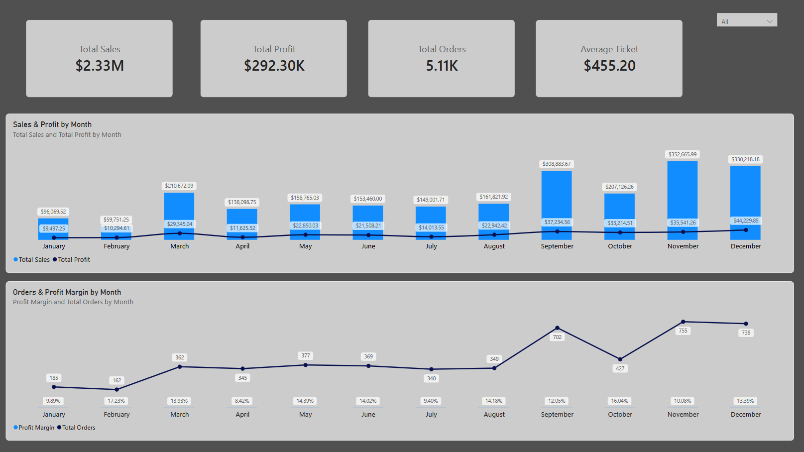

# Sales & Profitability Analysis

An end-to-end analytics project evaluating commercial performance across 2023–2026, focusing on granular loss drivers, regional disparities, and the financial impact of aggressive discounting strategies.

## Executive Summary & Key KPIs

| Metric | Value | Context / Benchmark |
| :--- | :--- | :--- |
| **Total Sales** | $2.28M | Consistent upward trajectory from 2023 to 2026, with retraction in 2024 |
| **Total Profit** | $284K | Net profitability impacted by high discount outliers |
| **Overall Profit Margin** | ~12.5% | Stabilized around 13% post-2024 recovery |
| **Total Transactions** | 10,194 | Cleaned and validated records |

## Tools & Tech Stack

- **Python (Pandas, NumPy)** — Data quality assessment, anomaly detection, postal code standardization, and datetime validation.
- **PostgreSQL** — Schema design, CTEs and window functions (LAG) for year-over-year and profitability analysis.
- **Power BI Desktop** — Executive dashboarding and interactive reporting.

## Methodology & Data Quality

During the data preparation phase in Python, several data integrity issues were addressed to ensure a robust pipeline:
- **Duplicates & Schema:** Removed fully duplicated rows (ignoring unique row IDs) and mapped columns to strict snake_case matching the PostgreSQL schema.
- **Postal & Geographic Consistency:** Handled international records and padded US postal codes to preserve leading zeros.
- **Strict Datetime Validation:** Enforced zero-tolerance assertions on date conversions to prevent silent parsing failures.
- **Reproducibility:** Key analytical outputs are pre-computed and stored in [sql/results/](sql/results/) for quick auditing.

## Dashboard



(For a complete view of all report pages and cross-filtering capabilities, please check the exported PDF report in [Dashboard Report](docs/dashboard_report.pdf) or review the [Power BI file](powerbi/superstore_sales_analysis.pbix)).

The dashboard covers:
- Year-over-Year temporal trajectory and monthly performance
- Granular category and sub-category drill-downs
- Regional performance disparities
- Discount tiers and profitability impact

## Key Findings & Business Insights

SQL exploration and annual trend analysis uncovered critical business drivers that go beyond basic summaries:

- **Granular Loss Drivers in Furniture & Supplies:** While the Furniture category exhibits a weak overall margin (2.6%), a deep sub-category drill-down exposes the exact root causes: Tables (−8.5%), Bookcases (−3.2%), and Supplies (−2.5%) operate at a net loss, dragging down overall profitability.
- **The True Cost of Aggressive Discounting:** Discount strategy is tightly correlated with margin erosion. Orders with 0% discount yield a healthy 29.6% profit margin, whereas discounts above 20% result in a collective net loss of ~-$136,000 across 1,415 transactions.
- **Year-over-Year Trajectory (2023–2026):** Separating seasonal aggregation into distinct annual timelines reveals clear business phases:
  - 2023: Baseline performance with a ~10.5% profit margin.
  - 2024: A temporary market contraction marked by a -4.3% drop in sales.
  - 2025–2026: Strong market recovery, with sales surging +30% in 2025 and +21% in 2026, stabilizing profit margins around 13%.
- **Regional Performance:** The West region led performance with a strong 15% profit margin, while the Central region lagged behind at 8%.

*(Explore the underlying query outputs and data models in [sql/results/](sql/results/))*

## Strategic Recommendations

1. **Restructure Discount Policies:** Immediately cap or eliminate discounts exceeding 20% on high-risk product lines, as they systematically erode operating income.
2. **Portfolio Rationalization:** Audit product lines inside the Tables and Bookcases sub-categories to reprice, bundle, or discontinue chronic loss-makers.
3. **Regional Strategy Focus:** Investigate operational inefficiencies in the Central region to bridge the 7% margin gap compared to the West.


## Report

The full analysis, findings, and recommendations are available in the [Final Report PDF](docs/Report.pdf).

## Dataset

The project uses the [Superstore Sales Dataset on Kaggle](https://www.kaggle.com/datasets/himanshuuike/samplesuperstore)
The dataset is published under the **CC0: Public Domain license.**

## Project Structure

```text
sales-profitability-analysis/
├── data/
│   ├── raw/
│   └── processed/
├── notebooks/
│   ├── 01_data_quality.ipynb
│   └── 02_exploratory_analysis.ipynb
├── sql/
│   ├── results/
│   ├── 01_create_main.sql
│   ├── 02_analysis.sql
│   └── 03_view.sql
├── powerbi/
├── docs/
│   ├── Report.pdf
│   └── dashboard_report.pdf
├── images/
│   └── overview.png
├── .gitignore
├── LICENSE
├── README.md
└── requirements.txt
```
